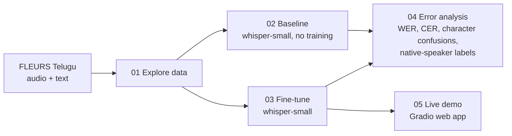

# Telugu Speech Recognition with Whisper

[](https://github.com/pavanadityav-ai/telugu-asr-whisper/actions/workflows/tests.yml)


Fine-tuning OpenAI's Whisper to recognise **Telugu** speech, measuring how much it improves, and analysing the remaining errors as a native speaker.

> **Status:** data exploration, baseline and fine-tuning done. Fine-tuning cut the test word error rate from **155.6% to 48.0%** and the character error rate from **163.9% to 13.7%**. Error analysis over the whole test set done (below); native-speaker labelling of the worst errors in progress. All numbers come from real runs.

## Why this project

Telugu has more than 80 million speakers, but speech recognition for it is far weaker than for English. Three things make it hard:

1. **Little training data.** The public FLEURS set has only about 3,000 Telugu clips.
2. **The tokenizer.** Whisper's tokenizer was built mostly from English text, so the same sentence needs about 9 times more tokens in Telugu than in English (112 vs 13).
3. **Rich word forms.** Telugu attaches endings to words (నాయకత్వం → నాయకత్వంలో, "in the leadership"), so many test words never appear in training.

## Questions

1. How well does Whisper recognise Telugu **out of the box**?
2. How much does **fine-tuning** on a small Telugu dataset help?
3. **What kinds of mistakes** remain, and why?

## The data at a glance

Measured in [notebook 01](notebooks/01_data_exploration.ipynb):

| Measure | Value |
|---|---|
| Training audio | 7.9 hours (2,302 clips) |
| Validation / test audio | 0.9 hours (311 clips) / 1.5 hours (472 clips) |
| Average clip | 12.4 seconds, 15.7 words |
| Different words in training | 9,474 |
| Test words never seen in training | 33% |
| Tokens for the same sentence | 13 in English vs 112 in Telugu |
| Training sentences over Whisper's 448-token limit | 21 (removed before training) |
| Speakers (training) | 72% female, 28% male |
| Training sentences containing English letters | 258 (11%) |

## Pipeline



| Notebook | What it does | Runtime |
|---|---|---|
| [01 Data exploration](notebooks/01_data_exploration.ipynb) | Hours of audio, clip lengths, speakers, vocabulary, tokens per sentence | CPU, ~5 min |
| [02 Baseline](notebooks/02_baseline_whisper.ipynb) | Scores pre-trained `whisper-small` on the test set | T4 GPU, ~20 min |
| [03 Fine-tuning](notebooks/03_finetune_whisper.ipynb) ([Kaggle version](notebooks/03_finetune_whisper_kaggle.ipynb)) | Trains on 2,302 clips, keeps the best checkpoint by validation CER, scores on test | T4 GPU, ~1.5–2 h |
| [04 Error analysis](notebooks/04_error_analysis.ipynb) ([Kaggle version](notebooks/04_error_analysis_kaggle.ipynb)) | Baseline vs fine-tuned, character confusions, seen vs unseen words, male vs female voices, native-speaker labels | CPU (Kaggle version: T4 GPU, ~6 min) |
| [05 Demo](notebooks/05_demo.ipynb) | Web app: record Telugu speech, get Telugu text | GPU |

Each notebook has an **Open in Colab** button at the top.

## Results

| Model | WER ↓ | CER ↓ |
|---|---|---|
| whisper-small (no fine-tuning) | 155.6% | 163.9% |
| **whisper-small (fine-tuned)** | **48.0%** | **13.7%** |

Test set: FLEURS Telugu test split (472 clips). Lower is better. Both baseline scores are above 100% because the model often repeats tokens in a loop, which adds many extra words and characters.

### What the baseline gets wrong

From [notebook 02](notebooks/02_baseline_whisper.ipynb):

- **Wrong script:** only 6% of predictions are written in Telugu letters. Many are in Kannada or Hindi script, and some are close phonetic spellings of the Telugu sentence in Hindi letters, so the model hears Telugu better than it can write it.
- **Repetition loops:** the decoder gets stuck repeating one token ("ಲಿಲಿಲಿ...", "11 11 11...") until the token limit. One long loop is a single wrong word but hundreds of wrong characters, which is why CER is higher than WER here.
- **Translation instead of transcription:** some outputs are in English even though the task was set to Telugu transcription.

### Fine-tuning run

Trained on a free Kaggle T4 GPU with the [Kaggle version of notebook 03](notebooks/03_finetune_whisper_kaggle.ipynb): 2,280 of 2,302 training clips kept (22 were over 30 seconds or 448 tokens), 1,500 steps of 16 clips (about 10.5 passes over the data), 85 minutes of training.

| Step | Epoch | Validation loss | Validation WER | Validation CER |
|---|---|---|---|---|
| 500 | 3.5 | 0.187 | 50.5% | 12.86% |
| 1000 | 7.0 | 0.240 | 48.3% | 12.72% |
| 1500 | 10.5 | 0.282 | 47.7% | 12.59% |

- **Big jump first, then small gains.** Most of the improvement came in the first 500 steps. Steps 500 to 1,500 improved validation CER by only 0.3 points.
- **Overfitting signal.** Training loss fell from 1.6 to about 0.002, while validation loss rose from 0.19 to 0.28. WER and CER still improved slightly, so the step-1,500 checkpoint (lowest validation CER) was kept, but more steps on the same data are unlikely to help.
- **The remaining errors look like Telugu sound confusions** in the example outputs: long vs short vowels (శాస్త్రీయ → శాస్త్రియ), aspirated vs plain consonants (ప్రశ్నలు → ఫ్రష్ణలు), and numbers written differently from the reference ("802 11a" spoken out as Telugu number words; ఒకటి written as "1").

### Error analysis

All 472 test sentences, baseline vs fine-tuned ([Kaggle version of notebook 04](notebooks/04_error_analysis_kaggle.ipynb); the re-created baseline gave exactly the same scores, 155.6% / 163.9%).

- **Every sentence improved.** The character error rate went down for all 472 test sentences; none stayed the same or got worse.
- **Wrong script is fixed.** 94% of the baseline's outputs were mostly not in Telugu script; after fine-tuning, 0%.
- **Short clips were the baseline's worst case, not the fine-tuned model's.** Baseline CER on the shortest quarter of clips was 263% (repetition loops); the fine-tuned model stays between 12% and 15% for every clip length.
- **New word forms are the main remaining problem.** A third of the test words (2,615 of 7,894) never appear in the training text. The fine-tuned model gets 63.8% of seen words exactly right, but only 36.3% of unseen ones. Telugu builds long words from many parts, so a small training set cannot cover them, which also explains why WER (48%) stays much higher than CER (13.7%).
- **Most character errors are small marks.** The most common mistakes are a missing or extra virama ్ (340 deletions, 205 insertions) and missing vowel signs ా, ు, ి. The most common swap is long ీ written as short ి (67 times), and the reverse (60 times): vowel length, as seen in the examples above.
- **No disadvantage for male voices**, although 72% of training clips are female. The test set is mostly male (357 of 472 clips), and the fine-tuned CER is 13.6% for male and 13.9% for female speakers (WER 46.3% vs 52.9%).

| Word type | Words in test set | Recognised exactly: baseline | Recognised exactly: fine-tuned |
|---|---|---|---|
| Seen in training | 5,279 | 0.1% | 63.8% |
| Never seen in training | 2,615 | 0.2% | 36.3% |

Next step: labelling the 40 worst sentences by error type as a native speaker (notebook 04, section 8).

## Design choices

- **A custom text normaliser** ([`src/text_utils.py`](src/text_utils.py)). Whisper's built-in normaliser deletes Unicode "mark" characters. In Telugu, vowel signs like ా and ి are marks, so it would corrupt every word and make the scores meaningless. This normaliser removes only punctuation and invisible characters.
- **Metrics written from scratch** ([`src/metrics.py`](src/metrics.py)). WER and CER use a dynamic-programming edit distance with backtracking. The same alignment is reused to find *which* characters get confused. The results are checked against the `jiwer` library in every run.
- **CER next to WER.** One wrong vowel sign makes a whole long Telugu word "wrong" in WER. CER shows how close the model actually was.
- **Best checkpoint by validation CER**, not the last one, to avoid overfitting on a small dataset.
- **Filtering:** clips over 30 s or text over 448 tokens are removed, because Whisper cannot process them.

## Repository layout

```
notebooks/   01–05 Colab notebooks (the experiments)
src/         reusable code: data loading, text normalisation, metrics, transcription
tests/       unit tests for the metrics and normaliser (run on every push)
docs/        HOW_IT_WORKS.md: plain-English explanation of every step
```

## How to run

1. Open a notebook in Colab with its **Open in Colab** button.
2. For notebooks 02, 03 and 05: *Runtime → Change runtime type → T4 GPU*.
3. *Runtime → Run all*. Results are saved to `MyDrive/telugu-asr-whisper/` in Google Drive.

Run the unit tests locally:

```
pip install pytest numpy
python -m pytest -q
```

## How it was built

I used **Claude (Anthropic) as an AI coding assistant** to help design the pipeline and write the code. [docs/HOW_IT_WORKS.md](docs/HOW_IT_WORKS.md) explains every part in plain English. The experiments run on my own Colab and Kaggle accounts, and the native-speaker labelling of errors is my own work.

## References

- Radford et al., 2022. [Robust Speech Recognition via Large-Scale Weak Supervision](https://arxiv.org/abs/2212.04356) (Whisper).
- Conneau et al., 2022. [FLEURS: Few-shot Learning Evaluation of Universal Representations of Speech](https://arxiv.org/abs/2205.12446).
- Hugging Face. [Fine-Tune Whisper for Multilingual ASR with Transformers](https://huggingface.co/blog/fine-tune-whisper).
