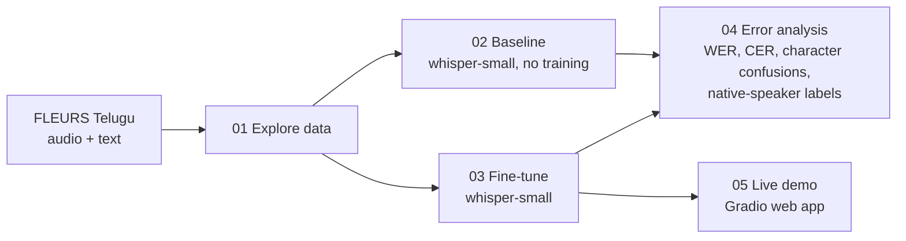

# Telugu Speech Recognition with Whisper

[](https://github.com/pavanadityav-ai/telugu-asr-whisper/actions/workflows/tests.yml)


Fine-tuning OpenAI's Whisper to recognise **Telugu** speech, measuring how much it improves, and analysing the remaining errors as a native speaker.

> **Status:** data exploration done ([notebook 01](notebooks/01_data_exploration.ipynb)); baseline and fine-tuning runs in progress. The results table is filled in only with numbers from real runs.

## Why this project

Telugu has more than 80 million speakers, but speech recognition for it is far weaker than for English. Three things make it hard:

1. **Little training data.** The public FLEURS set has only about 3,000 Telugu clips.
2. **The tokenizer.** Whisper's tokenizer was built mostly from English text, so the same sentence needs about 9 times more tokens in Telugu than in English (112 vs 13).
3. **Rich word forms.** Telugu attaches endings to words (నాయకత్వం → నాయకత్వంలో, "in the leadership"), so many test words never appear in training.

## Questions

1. How well does Whisper recognise Telugu **out of the box**?
2. How much does **fine-tuning** on a small Telugu dataset help?
3. **What kinds of mistakes** remain, and why?

## The data at a glance

Measured in [notebook 01](notebooks/01_data_exploration.ipynb):

| Measure | Value |
|---|---|
| Training audio | 7.9 hours (2,302 clips) |
| Validation / test audio | 0.9 hours (311 clips) / 1.5 hours (472 clips) |
| Average clip | 12.4 seconds, 15.7 words |
| Different words in training | 9,474 |
| Test words never seen in training | 33% |
| Tokens for the same sentence | 13 in English vs 112 in Telugu |
| Training sentences over Whisper's 448-token limit | 21 (removed before training) |
| Speakers (training) | 72% female, 28% male |
| Training sentences containing English letters | 258 (11%) |

## Pipeline



| Notebook | What it does | Runtime |
|---|---|---|
| [01 Data exploration](notebooks/01_data_exploration.ipynb) | Hours of audio, clip lengths, speakers, vocabulary, tokens per sentence | CPU, ~5 min |
| [02 Baseline](notebooks/02_baseline_whisper.ipynb) | Scores pre-trained `whisper-small` on the test set | T4 GPU, ~20 min |
| [03 Fine-tuning](notebooks/03_finetune_whisper.ipynb) | Trains on 2,302 clips, keeps the best checkpoint by validation CER, scores on test | T4 GPU, ~1.5–2 h |
| [04 Error analysis](notebooks/04_error_analysis.ipynb) | Baseline vs fine-tuned, character confusions, seen vs unseen words, male vs female voices, native-speaker labels | CPU |
| [05 Demo](notebooks/05_demo.ipynb) | Web app: record Telugu speech, get Telugu text | GPU |

Each notebook has an **Open in Colab** button at the top.

## Results

| Model | WER ↓ | CER ↓ |
|---|---|---|
| whisper-small (no fine-tuning) | _pending_ | _pending_ |
| whisper-small (fine-tuned) | _pending_ | _pending_ |

Test set: FLEURS Telugu test split (472 clips). Lower is better.

### Error analysis

_To be added after notebook 04: top character confusions, seen vs unseen words, and native-speaker error categories._

## Design choices

- **A custom text normaliser** ([`src/text_utils.py`](src/text_utils.py)). Whisper's built-in normaliser deletes Unicode "mark" characters. In Telugu, vowel signs like ా and ి are marks, so it would corrupt every word and make the scores meaningless. This normaliser removes only punctuation and invisible characters.
- **Metrics written from scratch** ([`src/metrics.py`](src/metrics.py)). WER and CER use a dynamic-programming edit distance with backtracking. The same alignment is reused to find *which* characters get confused. The results are checked against the `jiwer` library in every run.
- **CER next to WER.** One wrong vowel sign makes a whole long Telugu word "wrong" in WER. CER shows how close the model actually was.
- **Best checkpoint by validation CER**, not the last one, to avoid overfitting on a small dataset.
- **Filtering:** clips over 30 s or text over 448 tokens are removed, because Whisper cannot process them.

## Repository layout

```
notebooks/   01–05 Colab notebooks (the experiments)
src/         reusable code: data loading, text normalisation, metrics, transcription
tests/       unit tests for the metrics and normaliser (run on every push)
docs/        HOW_IT_WORKS.md: plain-English explanation of every step
```

## How to run

1. Open a notebook in Colab with its **Open in Colab** button.
2. For notebooks 02, 03 and 05: *Runtime → Change runtime type → T4 GPU*.
3. *Runtime → Run all*. Results are saved to `MyDrive/telugu-asr-whisper/` in Google Drive.

Run the unit tests locally:

```
pip install pytest numpy
python -m pytest -q
```

## How it was built

I used **Claude (Anthropic) as an AI coding assistant** to help design the pipeline and write the code. [docs/HOW_IT_WORKS.md](docs/HOW_IT_WORKS.md) explains every part in plain English. I run the experiments myself in Colab, and the error analysis and native-speaker labelling are my own work.

## References

- Radford et al., 2022. [Robust Speech Recognition via Large-Scale Weak Supervision](https://arxiv.org/abs/2212.04356) (Whisper).
- Conneau et al., 2022. [FLEURS: Few-shot Learning Evaluation of Universal Representations of Speech](https://arxiv.org/abs/2205.12446).
- Hugging Face. [Fine-Tune Whisper for Multilingual ASR with Transformers](https://huggingface.co/blog/fine-tune-whisper).
